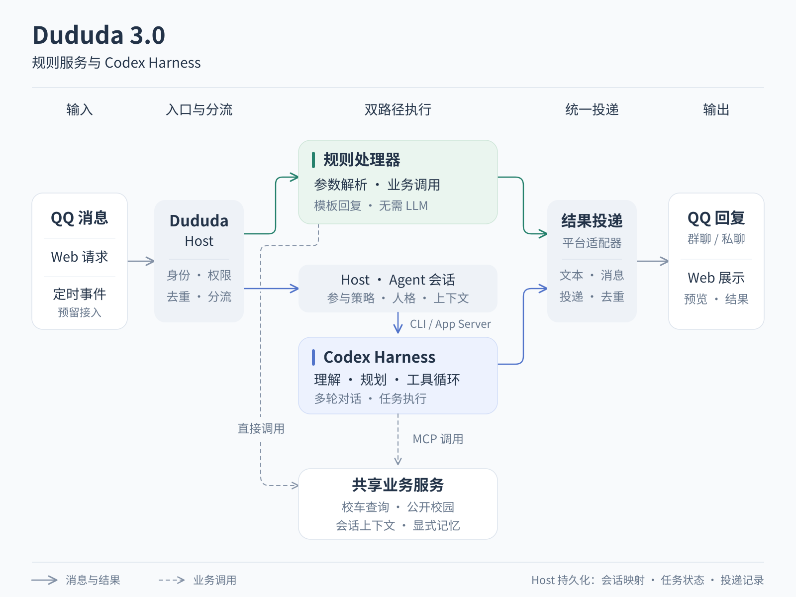

# Dududa 3.0 Runtime

3.0 使用独立 Python Host 承载确定性规则和 Agent 两条路径。Agent 路径调用**本机安装的 Codex CLI App Server**，不依赖 Python Codex SDK，也不经过 2.0 的感知、模型路由或单步能力计划。



## 代码边界

| 文件 / 目录 | 责任 |
| --- | --- |
| `packages/dududa-runtime/src/dududa_v3/__main__.py` | `check`、`chat`、`serve` 命令与令牌文件 |
| `config.py` | JSON 配置、环境变量和工作区位置 |
| `runtime.py` | 身份范围检查、规则分流、参与条件、任务、会话和 Codex 调度 |
| `codex.py` | 本机 CLI 子进程、stdio JSON-RPC、thread / turn、事件与中断 |
| `store.py` | SQLite 会话、消息、记忆、运行状态及投递记录 |
| `server.py` | Python 标准库 `ThreadingHTTPServer`，将请求交给异步 Runtime |
| `mcp.py`、`services.py` | 绑定会话身份的原生 MCP stdio 服务与公开业务入口 |
| `services/builtin/shuttle/` | 独立校车查询逻辑与静态版本化资料 |
| `apps/web/server/runtime-v3.ts` | Host HTTP 客户端、Web 预览、QQ 适配与投递 |
| `services/mcp/` | 共享校园服务，按各自依赖和部署方式独立运行 |
| `legacy/2.0/` | 完整历史快照；不作为 3.0 主执行链 |

根 Python workspace 仅安装新 Runtime，不安装旧 `dududa-agent`。MCP Console 保留原有业务实现，使用它时需要独立准备其历史运行环境；根目录 `uv sync` 不会启动或验证全部校园服务。

## 一条消息如何执行

1. 适配器提交账号、会话、发送者、消息 ID、正文和触发信息。HTTP token 认证适配器，平台身份由受信任适配器提供，不从消息正文推断。
2. Host 检查范围并按会话与消息 ID 去重，保存消息，匹配内置命令及配置中的精确文本规则。
3. 规则命中后直接调用业务或生成回复，完全不需要模型。普通群消息未满足参与条件时记录为忽略。
4. Agent 消息进入同会话串行队列，跨会话受并发数限制。Host 从 SQLite 获取对应 Codex thread，并为运行建立会话工作目录。
5. `codex.py` 直接启动本机可执行文件，使用 `app-server --listen stdio://` 交换 JSON-RPC。首次建立 thread，后续恢复 thread；恢复失败明确报错，不静默新开或切回 2.0。
6. Codex 在一次 turn 内自主执行多步工具调用，Host 保存任务状态和进度元数据。最终回答进入平台输出，不把中间 commentary 当最终回复。
7. QQ 适配器取得该 run 的投递权后发送，记录 `sent` 或 `unknown`。发送结果未知时不自动重发。

Web 预览与 QQ 正式会话使用独立状态。预览可以提供近期消息背景，但不会通过 `/remember`、`/forget` 修改正式会话记忆。`/new` 重置 Codex 对话，显式保存的记忆继续保留。

## 工具范围与账号配置

本机 Codex 继续使用用户已有登录及模型设置；Host 不复制认证文件，也不创建另一套 `CODEX_HOME`。Host 为每次运行覆盖工具配置，关闭 Shell、通用 App / 插件和个人 MCP，仅启用当前会话绑定的 Dududa MCP。进程、thread 和 turn 使用只读与不批准额外操作的设置。

MCP 当前提供 `shuttle_query`、`memory_search`、`context_recent`、`services_list`、`campus_query`。身份由 Host 启动参数绑定，不接受模型传入 `user_id` 或管理员标志。记忆写入和删除只通过明确的 Host 规则命令执行。

`campus_query` 需要配置 Console 地址与能力白名单，并核对公开属性、支持的会话类型及可用状态。当前不开放私人 CAS 数据、作业提交或任意消息发送。Codex 的文件沙箱不代替这些业务权限检查。

## HTTP API

默认地址为 `http://127.0.0.1:8783`。所有接口要求 `Authorization: Bearer <token>`，返回 JSON，包含 `runtime: "dududa-3.0"` 标记。接口供受信任的本机适配器使用，不直接承担 QQ 用户登录。

| 方法 | 路径 | 用途 |
| --- | --- | --- |
| `GET` | `/v3/health` | 版本、本机 CLI 可用性、活动任务数；不会发起模型调用 |
| `POST` | `/v3/runs` | 创建或返回同一消息对应的任务 |
| `GET` | `/v3/runs/{run_id}` | 轮询状态、最终文本、thread / turn 和进度元数据 |
| `POST` | `/v3/runs/{run_id}/cancel` | 取消任务，必要时中断 Codex turn |
| `POST` | `/v3/runs/{run_id}/delivery` | 平台适配器申领投递或记录 `sending` / `sent` / `unknown` |

创建请求：

```json
{
  "account_id": "local",
  "conversation_id": "private:demo",
  "user_id": "owner",
  "message_id": "demo-001",
  "text": "/ping",
  "source": "web",
  "mentioned": true,
  "preview": true
}
```

账号、会话、用户、消息 ID 和正文均必填。`source` 支持 `web`、`qq`、`timer`；QQ 和 timer 范围需要白名单。`history` 可传入适配器准备的近期背景。`timer` 是输入类型，尚不包含内置调度器。

任务状态为 `queued`、`running`、`completed`、`failed`、`cancelled`、`ignored`；路由为 `rule`、`agent`、`ignore`。运行失败保持失败，不回退到旧 Runtime。HTTP 使用 401 表示 token 无效、403 表示会话范围未开放、400 表示参数不合法、404 表示资源不存在。

## 本轮边界

- 3.0 已有本机 Codex、连续会话、多步 MCP、规则服务、轻量显式记忆和 Web / QQ 适配；校车通过本地静态资料运行。
- 旧控制台的模型档位、Persona 选择与群策略不修改 Codex。当前人格从 `configs/personas/dududa.md` 读取。
- 主动参与仅有显式范围及冷却配置；旧 Social Engine 的概率、语义决策和自适应插件启用尚未迁移。
- Web 当前轮询并展示最终回答，专门的流式事件与取消按钮尚未接入；客户端超时会请求取消。
- 通知订阅、作业草稿与提交、助教汇报、互动插件和完整 Memory v2 保存在 2.0，未迁移或自动启用。
- 真实本机 CLI 验证与协议测试分别报告；2.0 历史结果不算 3.0 证据。

启动方式见 [3.0 操作说明](../operations/v3.md)，历史源码恢复见 [2.0 封存记录](../archive/2.0/ARCHIVE.md)。
